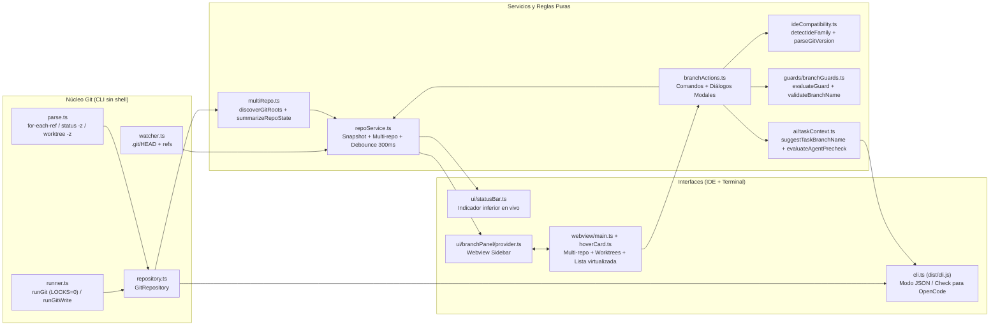

# Walkthrough de Implementación y Mejoras — BranchPilot

> [!IMPORTANT]
> **Propósito de BranchPilot:** Extensión ligera y segura para VS Code (y forks como Antigravity, Cursor, Windsurf, Qoder/Qwen, Kiro, Trae, VSCodium) y agentes de terminal (OpenCode, Claude Code, Aider) que mantiene **siempre visible y bajo control la rama activa de Git** durante sesiones de desarrollo asistido por IA.

---

## 1. Arquitectura General y Flujo de Datos

---

## 2. Resumen de Fases Completadas (F0 a F9)

| Fase | Estado | Qué se construyó y mejoró |
|---|---|---|
| **F0 · Base** | Completado | Configuración TypeScript `strict` (`noUncheckedIndexedAccess`, sin `any`), bundler con `esbuild`, ESLint, Vitest, CI multiplataforma y contrato de calidad en [CONSTRAINTS.md](file:///Users/leonfeliperodriguez/Desktop/Trabajos/BranchPilot/CONSTRAINTS.md). |
| **F1 · Núcleo Git** | Completado | Lectura atómica sin shell en [runner.ts](file:///Users/leonfeliperodriguez/Desktop/Trabajos/BranchPilot/src/git/runner.ts) con `GIT_OPTIONAL_LOCKS=0` para no bloquear `index.lock` mientras el agente opera; parseo de `for-each-ref`, `status --porcelain=v1 -z`, detección de rama base (`origin/HEAD`, `main`, `master`, `develop`, `trunk`), ramas fusionadas y observación reactiva de `.git` en [watcher.ts](file:///Users/leonfeliperodriguez/Desktop/Trabajos/BranchPilot/src/git/watcher.ts). |
| **F2 · Barra de estado** | Completado | Indicador permanente en [statusBar.ts](file:///Users/leonfeliperodriguez/Desktop/Trabajos/BranchPilot/src/ui/statusBar.ts) y modelo puro en [statusBarModel.ts](file:///Users/leonfeliperodriguez/Desktop/Trabajos/BranchPilot/src/shared/statusBarModel.ts): muestra nombre completo de la rama, asterisco `*` con cambios pendientes, operación activa (`merge`, `rebase`, `cherry-pick`) y fondo de advertencia si la rama es protegida o `HEAD` está desacoplado. |
| **F3 · Panel Webview** | Completado | Sidebar en la barra de actividad con tarjeta de rama actual, buscador instantáneo, 5 chips de filtro con contadores (*Todas*, *Locales*, *Remotas*, *Fusionadas*, *Antiguas*), lista virtualizada a 60 fps ([virtual.ts](file:///Users/leonfeliperodriguez/Desktop/Trabajos/BranchPilot/src/shared/virtual.ts)) y navegación completa por teclado (`ArrowUp/Down`, `PageUp/Down`, `Home/End`). |
| **F4 · Hover Card** | Completado | Tarjeta flotante de solo lectura ([hoverCard.ts](file:///Users/leonfeliperodriguez/Desktop/Trabajos/BranchPilot/src/ui/branchPanel/webview/hoverCard.ts)) con pestañas **Resumen** (divergencia en lenguaje natural, estado de integración, upstream) y **Commits** (carga perezosa bajo demanda con caché invalidada por hash). |
| **F5 · Acciones + Guards** | Completado | Operaciones de escritura seguras (`checkout`, `createBranch`, `renameBranch`, `deleteBranch`, `stashPush`) protegidas por una matriz de guards puros ([branchGuards.ts](file:///Users/leonfeliperodriguez/Desktop/Trabajos/BranchPilot/src/guards/branchGuards.ts)) y conectadas tanto a botones en el panel como a la paleta de comandos. |
| **F6 · Contexto IA** | Completado | Generador inteligente de nombres de rama por tarea (`feat/...`, `fix/...`, `refactor/...`), pre-chequeo interactivo antes de delegar al agente y generador idempotente de reglas en `AGENTS.md`, `.clinerules` y `.cursorrules` ([taskContext.ts](file:///Users/leonfeliperodriguez/Desktop/Trabajos/BranchPilot/src/ai/taskContext.ts)). |
| **F7 · Worktrees** | Completado | Soporte completo de `git worktree` para ejecutar 2 o más agentes en paralelo en carpetas/ventanas separadas sin colisionar: parser `--porcelain -z`, sección **Worktrees** en el panel, etiquetas `worktree` por fila, creación asistida, apertura en nueva ventana y eliminación segura. |
| **F8 · Compatibilidad IDEs + CLI** | Completado | Detector de familia de IDE (`antigravity`, `cursor`, `windsurf`, `kiro`, `trae`, `qoder`, `vscodium`, `vscode`) y versión de Git ([ideCompatibility.ts](file:///Users/leonfeliperodriguez/Desktop/Trabajos/BranchPilot/src/shared/ideCompatibility.ts)), comando de diagnóstico, tabla de compatibilidad en [README.md](file:///Users/leonfeliperodriguez/Desktop/Trabajos/BranchPilot/README.md) y binario CLI autónomo (`dist/cli.js` desde [cli.ts](file:///Users/leonfeliperodriguez/Desktop/Trabajos/BranchPilot/src/cli.ts)) para OpenCode / Claude Code / Aider. |
| **F9 · Multi-repositorio** | Completado | Descubrimiento automático de múltiples repositorios en workspaces multi-root, subcarpetas de primer nivel y rutas configuradas (`branchpilot.scanPaths`) en [multiRepo.ts](file:///Users/leonfeliperodriguez/Desktop/Trabajos/BranchPilot/src/shared/multiRepo.ts), con barra interactiva de píldoras de repositorio en la parte superior del panel y comando selector `branchpilot.switchRepository`. |

---

## 3. Detalle Técnico de las Fases Implementadas (F5 a F9)

### Fase 5 · Acciones de Ramas y Guards de Seguridad

- **Validación estricta de nombres ([`validateBranchName`](file:///Users/leonfeliperodriguez/Desktop/Trabajos/BranchPilot/src/guards/branchGuards.ts#L57-L68)):** rechaza nombres vacíos, reservados (`HEAD`, `@`), que inicien con `-`, secuencias `..`, `.lock`, caracteres de control o espacios.
- **Matriz de decisión pura ([`evaluateGuard`](file:///Users/leonfeliperodriguez/Desktop/Trabajos/BranchPilot/src/guards/branchGuards.ts#L88-L199)):**
  - Bloquea cambios o creaciones de rama si hay una operación Git en curso (`merge`, `rebase`, `cherry-pick`, `revert`, `bisect`) o archivos en conflicto (`conflicted > 0`).
  - Bloquea eliminar ramas remotas, la rama actual, la rama base o ramas en uso por otro worktree.
  - Respeta `branchpilot.protection.mode` (`all`, `list`, `off`) pidiendo confirmación antes de abandonar o renombrar una rama protegida.
  - Si hay cambios sin guardar (`isDirty`), ofrece **«Guardar en stash y continuar»** (`git stash push --include-untracked`), **«Cambiar llevando cambios»** o cancelar.
  - Diferencia la confirmación al eliminar una rama ya fusionada (`-d`) de una rama sin fusionar (`-D` con aviso del último commit).

---

### Fase 6 · Contexto de Tarea e Integración con Agentes de IA

- **Sugerencia inteligente de rama ([`suggestTaskBranchName`](file:///Users/leonfeliperodriguez/Desktop/Trabajos/BranchPilot/src/ai/taskContext.ts#L81-L97)):** infiere el prefijo convencional (`feat`, `fix`, `refactor`, `docs`, `test`, `chore`), limpia tildes y palabras vacías, y evita colisiones añadiendo sufijo incremental (`-2`, `-3`).
- **Pre-chequeo para agentes ([`evaluateAgentPrecheck`](file:///Users/leonfeliperodriguez/Desktop/Trabajos/BranchPilot/src/ai/taskContext.ts#L120-L186)):** alerta si el usuario está en `main` o `HEAD` desacoplado antes de delegar trabajo al agente y ofrece crear una rama de tarea con un clic.
- **Inyección idempotente de reglas ([`upsertAgentRuleInContent`](file:///Users/leonfeliperodriguez/Desktop/Trabajos/BranchPilot/src/ai/taskContext.ts#L213-L227)):** mantiene actualizado el bloque `<!-- branchpilot:start --> ... <!-- branchpilot:end -->` en `AGENTS.md`, `.clinerules` o `.cursorrules`.

---

### Fase 7 · Worktrees Paralelos y Bootstrap Instantáneo (`.env` + `node_modules`)

- **Parser de `git worktree list --porcelain -z` ([`parseWorktrees`](file:///Users/leonfeliperodriguez/Desktop/Trabajos/BranchPilot/src/git/parse.ts#L124-L171)):** identifica ruta, `HEAD`, rama, `isMain`, `isCurrent`, `locked` y `prunable`.
- **Operaciones en [`GitRepository`](file:///Users/leonfeliperodriguez/Desktop/Trabajos/BranchPilot/src/git/repository.ts#L226-L284) y [`BranchActions`](file:///Users/leonfeliperodriguez/Desktop/Trabajos/BranchPilot/src/branchActions.ts#L496-L650):** permite crear un worktree con rama nueva o existente en carpeta hermana, abrirlo en una nueva ventana del IDE y eliminarlo con confirmación.
- **Bootstrap automático de dependencias y entorno ([`bootstrapWorktree`](file:///Users/leonfeliperodriguez/Desktop/Trabajos/BranchPilot/src/git/worktreeBootstrap.ts#L45-L86)):**
  - Al crear un worktree paralelo, copia automáticamente los archivos ignorados por Git configurados en `branchpilot.worktree.copyIgnoredFiles` (`.env`, `.env.local`, `.env.development`, `.env.development.local`, `.env.test`) validando rutas seguras ([`isSafeRelativePath`](file:///Users/leonfeliperodriguez/Desktop/Trabajos/BranchPilot/src/git/worktreeBootstrap.ts#L29-L37)).
  - Si `branchpilot.worktree.linkNodeModules` está activo (por defecto `true`), enlaza simbólicamente `node_modules` (`junction` en Windows, `dir` en macOS/Linux) desde el repositorio principal hacia el nuevo worktree para que el agente en la segunda ventana pueda compilar y correr tests al instante sin reinstalar paquetes.

---

### Fase 7.5 · Auto-Guard Reactivo en Ramas Protegidas

- **Evaluador de transición limpio → sucio ([`evaluateProtectedBranchEditAlert`](file:///Users/leonfeliperodriguez/Desktop/Trabajos/BranchPilot/src/guards/autoGuard.ts#L26-L65)):** detecta el instante en que una rama protegida (`main`, `master`, `develop` o la rama base) pasa de estar limpia a tener archivos modificados (p. ej. cuando un agente empieza a aplicar cambios sin haber ejecutado el pre-chequeo).
- **Observador reactivo en el workspace ([`AutoGuardWatcher`](file:///Users/leonfeliperodriguez/Desktop/Trabajos/BranchPilot/src/ui/autoGuardWatcher.ts#L15-L102)):**
  - Escucha tanto los snapshots de `.git` como `onDidSaveTextDocument` y `onDidChangeTextDocument` sobre ramas protegidas.
  - Dispara una alerta no intrusiva con el botón **«Mover cambios a rama de tarea…»** ([`moveDirtyToTaskBranch`](file:///Users/leonfeliperodriguez/Desktop/Trabajos/BranchPilot/src/branchActions.ts#L350-L385)), que pide una descripción corta o nombre, sugiere el slug convencional y ejecuta `git checkout -b <rama> HEAD` trasladando todos los cambios sin guardar fuera de `main` en un solo paso.
  - Además, el encabezado del panel lateral muestra el botón naranja de rescate **«Mover cambios a rama de tarea…»** siempre que una rama protegida tenga cambios sin guardar.

---

### Fase 8 · Compatibilidad entre IDEs y CLI Auxiliar

- **Diagnóstico de entorno ([`ideCompatibility.ts`](file:///Users/leonfeliperodriguez/Desktop/Trabajos/BranchPilot/src/shared/ideCompatibility.ts)):**
  - [`detectIdeFamily`](file:///Users/leonfeliperodriguez/Desktop/Trabajos/BranchPilot/src/shared/ideCompatibility.ts#L38-L51) identifica Antigravity, Cursor, Windsurf, Kiro, Trae, Qoder/Qwen, VSCodium y VS Code.
  - [`parseGitVersion`](file:///Users/leonfeliperodriguez/Desktop/Trabajos/BranchPilot/src/shared/ideCompatibility.ts#L58-L73) verifica si el binario `git` soporta `%(ahead-behind:...)` (`>= 2.41`) y `worktree --porcelain -z` (`>= 2.15`), informando qué modo de respaldo está activo y si la extensión `vscode.git` está presente.
- **CLI auxiliar para OpenCode y agentes de terminal ([`src/cli.ts`](file:///Users/leonfeliperodriguez/Desktop/Trabajos/BranchPilot/src/cli.ts) → `dist/cli.js`):**
  - Soporta salida legible, `--json` (snapshot + pre-chequeo estructurado) y `--check` (devuelve código de salida `2` si la rama está protegida o bloqueada, ideal para pre-hooks de agentes en terminal).

---

### Fase 9 · Radar Multi-Repositorio (~20+ Repositorios)

- **Descubrimiento y resumen ([`src/shared/multiRepo.ts`](file:///Users/leonfeliperodriguez/Desktop/Trabajos/BranchPilot/src/shared/multiRepo.ts)):**
  - [`discoverGitRoots`](file:///Users/leonfeliperodriguez/Desktop/Trabajos/BranchPilot/src/shared/multiRepo.ts#L53-L98) inspecciona las carpetas del workspace y las rutas configuradas en `branchpilot.scanPaths`, incluyendo subcarpetas de primer nivel cuando una carpeta contenedora agrupa decenas de repositorios.
  - [`summarizeRepoState`](file:///Users/leonfeliperodriguez/Desktop/Trabajos/BranchPilot/src/shared/multiRepo.ts#L9-L47) calcula por cada repositorio: rama activa, si tiene cambios pendientes (`dirty` y `changesCount`), total de ramas locales, ramas locales **sin fusionar** (`unmergedLocalBranches`), ramas **antiguas** (`staleLocalBranches`) y total de `worktrees`.
- **Radar Multi-Repo interactivo en el panel y paleta:**
  - Incluye el filtro rápido **«Filtrar activos (M/N)» / «Con actividad (M)»** en el encabezado del Radar para mostrar únicamente los repositorios que tienen cambios sin guardar (`dirty`), ramas locales sin fusionar en `main` (`unmergedLocalBranches > 0`) o worktrees secundarios abiertos (`worktreesCount > 1`).
  - Cada tarjeta de repositorio cuenta con dos acciones directas: clic en el nombre/rama para inspeccionarlo en el panel actual y clic en el icono de ventana (`Abrir en nueva ventana`) o mediante el comando `branchpilot.openRepositoryInWindow` (**«BranchPilot: Abrir repositorio en nueva ventana…»**).

### Fase 11 · Red de Seguridad (`Undo` + `Reflog`), Monorepos `pnpm`, `i18n` (`es`/`en`) y Rendimiento a Escala

- **Pila de deshacer en memoria + respaldo en `git reflog` ([`src/git/undoStack.ts`](file:///Users/leonfeliperodriguez/Desktop/Trabajos/BranchPilot/src/git/undoStack.ts)):**
  - Antes de ejecutar `deleteBranch`, `renameBranch` o `checkout`, [`BranchActions`](file:///Users/leonfeliperodriguez/Desktop/Trabajos/BranchPilot/src/branchActions.ts#L128-L320) registra una entrada inmutable en [`UndoStack`](file:///Users/leonfeliperodriguez/Desktop/Trabajos/BranchPilot/src/git/undoStack.ts#L53-L88) (incluyendo el SHA completo de 40 caracteres al eliminar una rama local).
  - Al eliminar cualquier rama local, el toast de confirmación ofrece el botón **«Deshacer»**, que ejecuta [`restoreBranch`](file:///Users/leonfeliperodriguez/Desktop/Trabajos/BranchPilot/src/git/repository.ts#L232-L244) (`git branch <nombre> <sha>`) al instante.
  - Si la pila en memoria está vacía (p. ej. tras recargar la ventana), el comando `branchpilot.undoLastBranchAction` (disponible en la paleta y en el botón `Deshacer` de la barra de herramientas del panel) consulta [`recentReflog`](file:///Users/leonfeliperodriguez/Desktop/Trabajos/BranchPilot/src/git/repository.ts#L247-L260) para recuperar cualquier estado reciente.
- **Detección inteligente de gestores de paquetes y monorepos `pnpm` ([`detectPackageManager`](file:///Users/leonfeliperodriguez/Desktop/Trabajos/BranchPilot/src/git/worktreeBootstrap.ts#L57-L103)):**
  - Detecta `pnpm-workspace.yaml`, `pnpm-lock.yaml`, `bun.lockb` / `bun.lock`, `yarn.lock` y `package-lock.json`.
  - Si detecta un monorepo `pnpm-workspace.yaml`, evita crear un único symlink raíz de `node_modules` que dejaría paquetes internos rotos y ofrece ejecutar `pnpm install --prefer-offline` en segundo plano con [`runPackageInstall`](file:///Users/leonfeliperodriguez/Desktop/Trabajos/BranchPilot/src/git/worktreeBootstrap.ts#L106-L126).
- **Internacionalización completa (`es` / `en`):**
  - [package.nls.json](file:///Users/leonfeliperodriguez/Desktop/Trabajos/BranchPilot/package.nls.json) (inglés base para alcance global en Open VSX / Marketplace) y [package.nls.es.json](file:///Users/leonfeliperodriguez/Desktop/Trabajos/BranchPilot/package.nls.es.json) (español) localizan todos los comandos, vistas y propiedades de configuración.
  - [`src/shared/i18n.ts`](file:///Users/leonfeliperodriguez/Desktop/Trabajos/BranchPilot/src/shared/i18n.ts) adapta dinámicamente los textos del panel Webview según `vscode.env.language`.
- **Prueba de carga con 1,001 ramas ([`test/unit/largeRepoPerf.test.ts`](file:///Users/leonfeliperodriguez/Desktop/Trabajos/BranchPilot/test/unit/largeRepoPerf.test.ts)):**
  - Crea 1,000 ramas en una sola transacción (`git update-ref --stdin`) y verifica que `snapshot()` + filtrado + ordenación + ventana virtualizada respondan dentro del presupuesto de latencia.
- **Higiene de `.vsix` e icono para Marketplace (`128x128`):**
  - Generado [media/icon.png](file:///Users/leonfeliperodriguez/Desktop/Trabajos/BranchPilot/media/icon.png) (`128x128` RGBA) y depurado [.vscodeignore](file:///Users/leonfeliperodriguez/Desktop/Trabajos/BranchPilot/.vscodeignore) para excluir todos los archivos de desarrollo y pruebas.

### Fase 12 · Rediseño Visual de Identidad, Tooltips Flotantes Instantáneos, Integración con Source Control (`scm`) y Commit Rápido

- **Nuevo Logo e Identidad Diferenciadora ([`media/icon.svg`](file:///Users/leonfeliperodriguez/Desktop/Trabajos/BranchPilot/media/icon.svg) y [`media/icon.png`](file:///Users/leonfeliperodriguez/Desktop/Trabajos/BranchPilot/media/icon.png)):**
  - Se sustituyó el glifo genérico de bifurcación de Git por un emblema de **Nave Chevron de Navegación / Ala Delta Aeroespacial** que dirige trayectorias hacia dos balizas radar (`waypoints`).
  - En la barra de actividad del IDE se distingue al instante del icono nativo de Source Control.
  - En el Marketplace (`media/icon.png`, `128x128` px) cuenta con degradado cian-esmeralda sobre fondo azul medianoche y supersampling subpixel antialias.
- **Tooltips Flotantes Instantáneos con CSS Puro ([`media/webview.css`](file:///Users/leonfeliperodriguez/Desktop/Trabajos/BranchPilot/media/webview.css#L872-L960)):**
  - Eliminado el retraso de 1+ segundo del `title` de HTML en el Webview mediante `[data-tooltip]` con microanimaciones CSS de 100 ms y variables nativas del tema (`--vscode-editorHoverWidget-background`, `--vscode-editorHoverWidget-border`).
  - Soportan orientación dinámica (`data-tooltip-pos="left"` o `"bottom"`) en la barra de herramientas, worktrees, chips y botones de fila.
- **Corrección de "Spanglish" y Simplificación de Badges:**
  - Se internacionalizaron todas las etiquetas de fila y el pie de página mediante [`UiStrings`](file:///Users/leonfeliperodriguez/Desktop/Trabajos/BranchPilot/src/shared/i18n.ts#L33-L70).
  - Eliminada la saturación de 4 badges en `main` (`[local] [actual] [base] [protegida]`): ahora las ramas locales no repiten innecesariamente `[local]`, y en `main` solo se muestran las etiquetas críticas indispensables (`[actual]` y `[protegida]`).
- **Caja Rápida de Commit y Puente a Source Control:**
  - Cuando el árbol de trabajo tiene cambios sin guardar (`isDirty`), la tarjeta de rama activa despliega un input inline + botón **«Commit»** (ejecuta [`commitAll`](file:///Users/leonfeliperodriguez/Desktop/Trabajos/BranchPilot/src/git/repository.ts#L262-L270)) y un botón con acceso directo al panel nativo de Source Control (`workbench.view.scm`) para revisar diffs detallados o redactar mensajes con GitHub Copilot.
  - Si el usuario intenta hacer commit directo sobre una rama protegida (`main`), BranchPilot advierte mediante un diálogo modal y sugiere trasladar los cambios a una rama de tarea aislada.
- **Acoplamiento Nativo en Source Control ([`package.json`](file:///Users/leonfeliperodriguez/Desktop/Trabajos/BranchPilot/package.json#L54-L61) y [`src/extension.ts`](file:///Users/leonfeliperodriguez/Desktop/Trabajos/BranchPilot/src/extension.ts#L38)):**
  - Se registró la vista de BranchPilot en el contenedor `"views": { "scm": [...] }`, permitiendo abrirla y organizarla dentro de la misma pestaña de Source Control junto a Cambios y Commits, además de mantener su acceso independiente en la barra de actividad.

### Fase 13 · Pulido Quirúrgico de UX sobre Repositorio Real (`Papa_Bullet`)

- **A. Eliminación total de "Spanglish" en Fechas Relativas, Resúmenes y HoverCard ([`src/shared/time.ts`](file:///Users/leonfeliperodriguez/Desktop/Trabajos/BranchPilot/src/shared/time.ts), [`src/shared/branchSummary.ts`](file:///Users/leonfeliperodriguez/Desktop/Trabajos/BranchPilot/src/shared/branchSummary.ts) y [`src/ui/branchPanel/webview/hoverCard.ts`](file:///Users/leonfeliperodriguez/Desktop/Trabajos/BranchPilot/src/ui/branchPanel/webview/hoverCard.ts)):**
  - [`relativeTime`](file:///Users/leonfeliperodriguez/Desktop/Trabajos/BranchPilot/src/shared/time.ts#L22-L35) y [`shortRelativeTime`](file:///Users/leonfeliperodriguez/Desktop/Trabajos/BranchPilot/src/shared/time.ts#L38-L41) ahora reciben `locale: Locale = 'es'`, formateando `just now`, `2 minutes ago`, `10 days ago`, `2 months ago` cuando el IDE está en inglés, y `hace un momento`, `hace 10 días` en español.
  - Se eliminaron mezclas como `Remotes updated hace 2 minutos (last fetch).` en el pie de página y `hace 10 días` en las subtítulos de fila.
  - [`divergenceText`](file:///Users/leonfeliperodriguez/Desktop/Trabajos/BranchPilot/src/shared/branchSummary.ts#L7-L32), [`integrationText`](file:///Users/leonfeliperodriguez/Desktop/Trabajos/BranchPilot/src/shared/branchSummary.ts#L34-L40) y la tarjeta emergente [`HoverCard`](file:///Users/leonfeliperodriguez/Desktop/Trabajos/BranchPilot/src/ui/branchPanel/webview/hoverCard.ts#L28-L175) ahora respetan íntegramente el idioma activo del IDE.
- **B. Supresión de Ruido Visual `↑0` en Filas de Rama ([`src/ui/branchPanel/webview/main.ts`](file:///Users/leonfeliperodriguez/Desktop/Trabajos/BranchPilot/src/ui/branchPanel/webview/main.ts#L814-L822) y [`media/webview.css`](file:///Users/leonfeliperodriguez/Desktop/Trabajos/BranchPilot/media/webview.css#L583-L600)):**
  - En las filas de la lista de ramas (`renderRow`), ahora solo se pinta `↑X` en verde cuando `ahead > 0` y `↓Y` en naranja cuando `behind > 0`. Si una rama está únicamente por detrás de `main` (`ahead === 0, behind === 16`), la columna derecha muestra limpiamente `↓16` sin el falso indicador verde `↑0`.
  - En la cabecera `Versus main`, cualquier contador en cero usa la clase `.zero` (`opacity: 0.4; color: var(--bp-muted)`).
- **C. Jerarquía Visual Coherente de Botones sobre Ramas Protegidas ([`src/ui/branchPanel/webview/main.ts`](file:///Users/leonfeliperodriguez/Desktop/Trabajos/BranchPilot/src/ui/branchPanel/webview/main.ts#L408-L456) y [`media/webview.css`](file:///Users/leonfeliperodriguez/Desktop/Trabajos/BranchPilot/media/webview.css#L287-L355)):**
  - Cuando el usuario está sobre una rama protegida (`main`) con cambios pendientes, la barra de commit rápido y su botón adoptan la variante `.caution` (borde y texto ámbar secundario: `Commit to main` / `Commit en main`), cediendo el protagonismo visual al botón primario azul **`+ Task branch`** y al botón de rescate **`→ Move changes to task branch...`**.
- **D. Truncado Limpio (`ellipsis`) en Nombres Largos de Rama ([`media/webview.css`](file:///Users/leonfeliperodriguez/Desktop/Trabajos/BranchPilot/media/webview.css#L510-L545)):**
  - Se ajustó `.row-name` (`flex: 0 1 auto; min-width: 0; max-width: 65%; overflow: hidden; text-overflow: ellipsis; white-space: nowrap`) y `.row-main` (`padding-right: 10px`) para que ramas con nombres largos (`origin/fix/badmergeybadalvaro`) se corten con `...` dejando siempre espacio respirable para los badges `[remote] [merged]` y la columna de divergencia `↓28`.

---

## 4. Métricas de Calidad y Paquete `.vsix`

- **Pruebas:** `15 passed` suites de test (**`93 passed` tests unitarios**, de integración, carga y guards).
- **Tipado & Lint:** TypeScript `strict` y ESLint con **0 errores y 0 advertencias**.
- **Tamaño de los bundles compilados (`npm run build`):**
  - `dist/extension.js`: **59.2 KB** (límite en `CONSTRAINTS.md`: `< 500 KB`).
  - `dist/webview.js`: **31.8 KB**.
  - `dist/cli.js`: **14.1 KB**.
- **Empaquetado `.vsix` limpio de producción (`npm run package`):**
  - Archivo generado: `/Users/leonfeliperodriguez/Desktop/Trabajos/BranchPilot/branchpilot-0.1.0.vsix` (**52.62 KB**, 13 archivos esenciales).
  - Instalado y validado en **Visual Studio Code** y **Antigravity IDE**.

